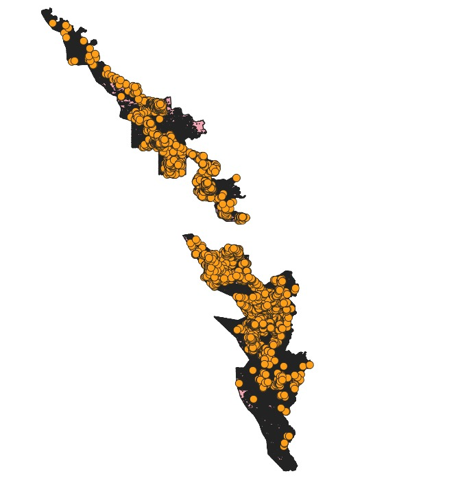
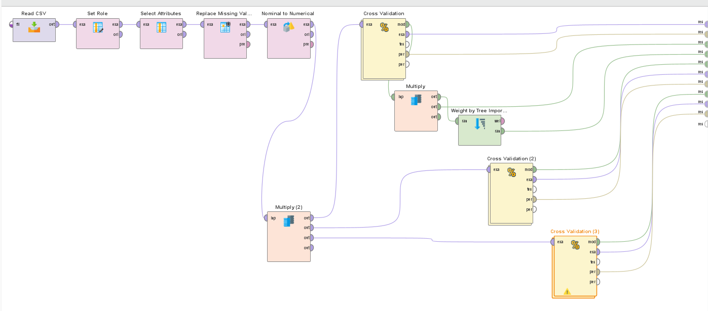
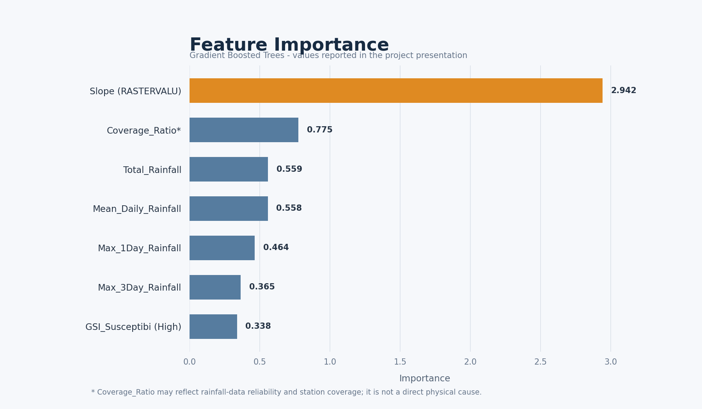

 Kerala Landslide Risk Estimation

A GIS and machine-learning project I developed for the IEDC Summit Data Science Contest. I combined Kerala's 2018 landslide inventory with rainfall, terrain, land-use, and landslide-susceptibility data to classify recorded landslide types.

**Achievement:** Consolation Prize, IEDC Summit Data Science Contest.

> This project classifies observed landslide types; it does not predict whether or when a landslide will occur.

## Project overview

I used QGIS for spatial processing and integration, then Altair AI Studio (RapidMiner) to compare models for three classes:

- Debris Flow
- Shallow/Surficial Slide
- Rockfall

## Data sources

- **2018 Kerala landslide inventory:** [University of Twente dataset](https://research.utwente.nl/en/datasets/landslide-inventory-of-the-2018-monsoon-rainfall-in-kerala-india/)
- **Rainfall observations:** [National Water Data Portal](https://nwdp.nwic.gov.in/)
- **Landslide susceptibility:** [Kerala State Disaster Management Authority hazard maps](https://sdma.kerala.gov.in/hazard-maps/)

Please consult the original sources for data licences and attribution requirements.

## Methodology

I processed and reprojected spatial data to **EPSG:32643**, joined susceptibility information, and associated rainfall station features using nearest-station analysis. I prepared a dataset of 4,606 events and compared Decision Tree, Random Forest, and Gradient Boosted Trees using 5-fold cross-validation.

## Results

- **Best reported model:** Gradient Boosted Trees
- **Accuracy:** 73.93%
- **Most important feature:** Slope, based on the reported feature-importance results

These results describe classification of recorded events, not prediction of future landslide occurrence. Feature importance indicates model reliance, not causation.

## Tools and technologies

QGIS · Altair AI Studio (RapidMiner) · Python/CSV and geospatial data · spatial joins · feature engineering · Decision Tree · Random Forest · Gradient Boosted Trees

## Repository contents

- `02_PROCESSED_DATA/` — processed ML and rainfall station CSV datasets
- `03_RAPIDMINER/` — machine-learning workflow
- `04_PRESENTATION/` — project presentation
- `screenshots/` — map, workflow, and feature-importance images

## Limitations

- The project focuses on the 2018 inventory and has no reliable non-landslide samples for occurrence modeling.
- Individual landslide dates were unavailable for reliable event-level, pre-event rainfall matching; nearest stations may also be distant.
- Further data and validation are needed before applying the findings to future risk or warning systems.

## Screenshots

## Acknowledgement

I developed this project for the IEDC Summit Data Science Contest, where it received a Consolation Prize.
